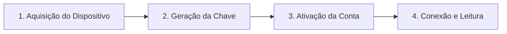

# LiBraille
### Tecnologia Assistiva Acessível para Leitura Tátil em Braille

 

[-238636?style=for-the-badge&logo=linktree&logoColor=black)](https://linktr.ee/LiBraille)

 

**Democratizando o acesso à leitura tátil por meio de hardware modular de baixo custo integrado a uma plataforma web inteligente.**

---

## Nossa História

O **LiBraille** nasceu durante o **Projeto Demoday do Instituto PROA**. Identificamos um problema na acessibilidade educacional e cultural: o acesso à leitura tátil em Braille ainda é restrito pelo custo elevado de dispositivos importados e pela falta de soluções integradas que apoiem tanto o leitor quanto o educador.

Acreditamos que a leitura é uma das principais formas de adquirir conhecimento, desenvolver a imaginação e conquistar autonomia. Foi pensando nisso que surgiu o LiBraille: uma iniciativa que une tecnologia, acessibilidade e inovação com um propósito claro de democratizar o acesso à leitura para pessoas com deficiência visual.

### Missão e Visão

* **Missão:** Possibilitar que pessoas com deficiência visual tenham maior acesso aos livros através da tecnologia.
* **Visão:** Democratizar o acesso ao conhecimento para pessoas com deficiência visual por meio de tecnologias inovadoras e acessíveis.

### Nossos Valores

> *"Mais do que tecnologia, acreditamos em criar possibilidades, promover independência e tornar a leitura acessível a todos."*

1. **Inovação:** Explorar a tecnologia para ampliar possibilidades.
2. **Empatia:** Considerar as necessidades reais das pessoas.
3. **Autonomia:** Valorizar a independência na experiência de leitura.
4. **Acessibilidade:** Pensar na acessibilidade desde o início.

---

## Sobre o Projeto

O sistema combina um **dispositivo físico de célula Braille única dinâmica (6 pinos)** com uma **plataforma web de conversão automática**. O usuário carrega um arquivo de texto no navegador, e o sistema traduz o conteúdo em tempo real para sinais táteis enviados ao aparelho, além de exibir um leitor visual sincronizado na tela.

### Principais Diferenciais

* **Baixo Custo e Manutenção Modular:** Construído com microcontrolador **ESP32-C3** e micro-servos padronizados, reduzindo drasticamente o valor final e facilitando reparos locais.
* **Controle Tátil Direto no Hardware:** Botões físicos no próprio dispositivo permitem ajustar a velocidade de passagem dos caracteres e navegar pelo texto sem depender exclusivamente da tela.
* **Privacidade por Concepção (LGPD):** Nenhum livro ou documento enviado pelo usuário fica armazenado no banco de dados. Toda a leitura e conversão para formato binário ocorre de forma transitória na sessão do navegador.

---

## Fluxo de Ativação de Conta e Uso

Para garantir o vínculo seguro entre o usuário e o hardware adquirido, o acesso à plataforma segue um fluxo objetivo em quatro etapas:

1. **Aquisição do Dispositivo:** O usuário realiza a solicitação do leitor físico LiBraille (cada unidade possui um identificador único de hardware).
2. **Emissão da Chave de Ativação:** Após a confirmação do pedido, o sistema disponibiliza uma chave de ativação vinculada ao dispositivo.
3. **Ativação e Cadastro na Plataforma:** Na tela de primeiro acesso do site, o usuário informa a chave recebida, cria suas credenciais (nome, e-mail e senha) e libera o painel de leitura.
4. **Conexão e Leitura Tátil:** Com a conta ativa, basta conectar o LiBraille ao computador via cabo USB, selecionar um arquivo de texto na sessão e iniciar a leitura tátil.

---

## Ecossistema e Repositórios

A arquitetura do LiBraille divide-se em repositórios independentes. Consulte o `README.md` específico de cada repositório para instruções técnicas de instalação, arquitetura e execução:

| Repositório | Responsabilidade | Tecnologias Principais |
| :--- | :--- | :--- |
| **[`libraille-frontend`](https://github.com/LiBraille/libraille-frontend)** | Interface web acessível, leitor visual sincronizado, fluxo de ativação e comunicação USB (Web Serial API). | React, JavaScript, HTML5, CSS3 |
| **[`libraille-backend`](https://github.com/LiBraille/libraille-backend)** | Serviços de API, regras de negócio, autenticação e integração com a camada de persistência. | Python, Supabase (PostgreSQL) |
| **[`libraille-firmware`](https://github.com/LiBraille/libraille-firmware)** | Código embarcado para recepção dos pacotes binários, controle de velocidade e acionamento dos 6 pinos táteis. | C++, ESP32-C3, PCA9685 |
| **[`Tradutor-Libraille`](https://github.com/LiBraille/Tradutor-Libraille)** | Módulo dedicado à transliteração de caracteres e regras do Braille para matriz de 6 bits. | Python |

---

## Segurança e Privacidade (LGPD)

O LiBraille adota o princípio da **minimização de dados**:
* **Zero retenção de livros:** Arquivos carregados para leitura existem apenas na memória temporária da aba ativa e desaparecem ao atualizar ou fechar o navegador, protegendo a privacidade do leitor até em computadores compartilhados de escolas e bibliotecas.
* **Isolamento de dados:** Credenciais trafegam sob criptografia e o banco de dados aplica políticas de segurança por linha (*Row Level Security* - RLS), para que cada usuário acesse apenas os próprios registros.

---

## Nossa Equipe

| Integrante | Função | Links |
| :--- | :--- | :--- |
| **Evandro Silva** | Product Owner (PO) & Modelagem de Protótipo | [LinkedIn](https://www.linkedin.com/in/evandro-jsilva/) • [GitHub](https://github.com/evandroqzn) |
| **Lucas Moreira Nunes de Souza** | Scrum Master (SM) & Full-Stack | [LinkedIn](https://www.linkedin.com/in/lucasmns7/) • [GitHub](https://github.com/LucMNS) |
| **Maria Eduarda** | Front-End & UI/UX Design | [LinkedIn](https://www.linkedin.com/in/mariaeduardalimadasilva/) • [GitHub](https://github.com/MariaEduarda907) |
| **Giovanna Macedo** | Front-End & UI/UX Design | [LinkedIn](https://www.linkedin.com/in/giovannamacedo8/) • [GitHub](https://github.com/giimacedo) |
| **Letícia Vitória** | Front-End | [LinkedIn](https://www.linkedin.com/in/let%C3%ADciavitorias/) • [GitHub](https://github.com/leticiavsdev) |
| **Victor Leonardo** | Back-End | [LinkedIn](https://www.linkedin.com/in/victorleonardoz/) • [GitHub](https://github.com/victorcaito) |
| **Guilherme Miranda** | Full-Stack | [LinkedIn](https://www.linkedin.com/in/guilhermemiranda0/) • [GitHub](https://github.com/gmm-tech) |

---

### *"Histórias que ganham relevo."*

