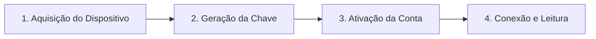

# LiBraille
### Tecnologia Assistiva Acessível para Leitura Tátil em Braille

**Democratizando o acesso à leitura tátil por meio de hardware modular de baixo custo integrado a uma plataforma web inteligente.**

---

## Sobre o Projeto

O **LiBraille** nasce para enfrentar uma das maiores barreiras da educação inclusiva no Brasil: o custo proibitivo das linhas e leitores Braille comerciais. Enquanto dispositivos importados ultrapassam milhares de reais e dependem de manutenção especializada no exterior, o LiBraille entrega uma alternativa portátil, modular e acessível.

O sistema combina um **dispositivo físico de célula Braille única dinâmica (6 pinos)** com uma **plataforma web de conversão automática**. O usuário carrega um arquivo de texto no navegador, e o sistema traduz o conteúdo em tempo real para sinais táteis enviados ao aparelho, além de exibir um leitor visual sincronizado na tela.

### Principais Diferenciais

* **Baixo Custo e Manutenção Modular:** Construído com microcontrolador **ESP32-C3**, driver PWM e micro-servos padronizados, o que reduz drasticamente o valor final e facilita reparos locais.
* **Ponte entre Leitor e Educador (Gêmeo Digital):** A interface web exibe o texto e a movimentação virtual dos pinos em sincronia com o aparelho físico. Professores, familiares e colegas sem domínio do Braille acompanham a leitura em tempo real, o que apoia diretamente o processo de alfabetização.
* **Controle Tátil Direto no Hardware:** Botões físicos no próprio dispositivo permitem ajustar a velocidade de passagem dos caracteres e navegar pelo texto sem depender exclusivamente da tela.
* **Privacidade por Concepção (LGPD):** Nenhum livro ou documento enviado pelo usuário fica armazenado no banco de dados. Toda a leitura e conversão para formato binário ocorre de forma transitória na sessão do navegador.

---

## Fluxo de Ativação de Conta e Uso

Para garantir o vínculo seguro entre o usuário e o hardware adquirido, o acesso à plataforma segue um fluxo objetivo em quatro etapas:

1. **Aquisição do Dispositivo:** O usuário realiza a solicitação do leitor físico LiBraille (cada unidade possui um identificador único de hardware).
2. **Emissão da Chave de Ativação:** Após a confirmação do pedido, o sistema disponibiliza uma chave de ativação vinculada ao dispositivo.
3. **Ativação e Cadastro na Plataforma:** Na tela de primeiro acesso do site, o usuário informa a chave recebida, cria suas credenciais (nome, e-mail e senha) e libera o painel de leitura.
4. **Conexão e Leitura Tátil:** Com a conta ativa, basta conectar o LiBraille ao computador via cabo USB, selecionar um arquivo de texto na sessão e iniciar a leitura tátil.

---

## Ecossistema e Repositórios

A arquitetura do LiBraille divide-se em repositórios independentes. Consulte o `README.md` específico de cada repositório para instruções técnicas de instalação, arquitetura e execução:

| Repositório | Responsabilidade | Tecnologias Principais |
| :--- | :--- | :--- |
| **`libraille-frontend`** | Interface web acessível, leitor visual sincronizado, fluxo de ativação e comunicação USB (Web Serial API). | React, JavaScript, HTML5, CSS3 |
| **`libraille-backend`** | Serviços de API, regras de negócio, autenticação e integração com a camada de persistência. | Python, Supabase (PostgreSQL) |
| **`libraille-firmware`** | Código embarcado para recepção dos pacotes binários, controle de velocidade e acionamento dos 6 pinos táteis. | C++, ESP32-C3, PCA9685 |
| **`tradutor-libraille`** | Módulo dedicado à transliteração de caracteres e regras do Braille para matriz de 6 bits. | Python |

---

## Segurança e Privacidade (LGPD)

O LiBraille adota o princípio da **minimização de dados**:
* **Zero retenção de livros:** Arquivos carregados para leitura existem apenas na memória temporária da aba ativa e desaparecem ao atualizar ou fechar o navegador, o que protege a privacidade do leitor até em computadores compartilhados de escolas e bibliotecas.
* **Isolamento de dados:** Credenciais trafegam sob criptografia e o banco de dados aplica políticas de segurança por linha (*Row Level Security* - RLS), para que cada usuário acesse apenas os próprios registros.

---

Histórias que ganham <b>relevo.</b>

